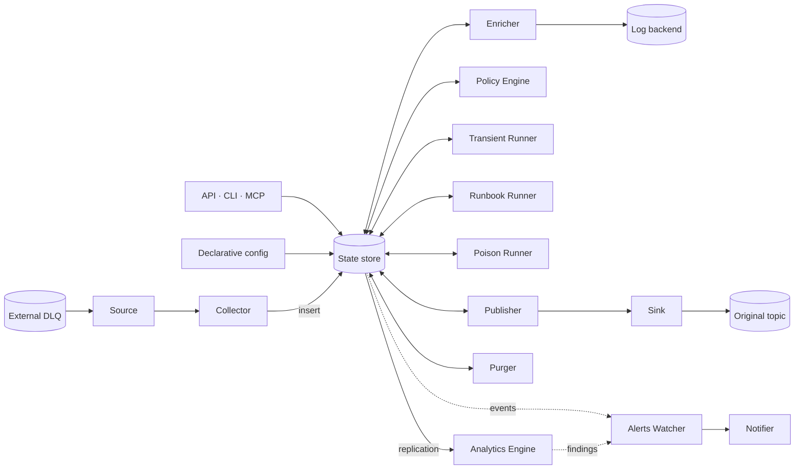

# Architecture

OpenDLQ follows the controller pattern used by Kubernetes. A single state store holds the state of every message and is the source of truth. Each component is a controller: it watches the messages in the state it owns, acts, and writes the new state. Components never call each other. The step-by-step sequence for each situation is in [flows](flows.md).

## Who decides

The **Policy Engine** is the only component that decides which path a message takes. The three **runners** execute a path:

| Path | Runner | Executes |
| --- | --- | --- |
| Transient | **Transient Runner** | Retry with backoff, circuit breaker, probe, drain |
| Known permanent | **Runbook Runner** | The declared runbook action, within its guardrails |
| Unknown permanent | **Poison Runner** | Grouping and announcement, so a person can decide |

A runner decides *how and when* within its path, following the declared `Policy`. It never picks another path. When a runner reaches the end of its path without success (a runbook action fails, an approval is rejected), it returns the message to `ready` with the outcome recorded, and the Policy Engine decides again. Operators are the other decision point: their actions are explicit and audited.

In Kubernetes terms, the Policy Engine plays the scheduler and the runners play the kubelet.

## Rules of the model

- A controller takes work with `SELECT ... FOR UPDATE SKIP LOCKED`. Two instances never take the same message.
- Every state change uses compare-and-set on `version`. A concurrent change fails and is discarded.
- Every state change writes a row to `transitions` in the same transaction. That table is both the audit log and the fact table for analytics.
- `LISTEN/NOTIFY` only wakes controllers up. It is not a source of truth. Without it, the controller finds the work on its next poll.
- No controller publishes to the broker. A controller that needs to replay writes a row to the `outbox` in the same transaction as the state change. Only the Publisher reads the outbox and publishes.
- An operator action is a write of desired state. The responsible controller carries it out.
- Any component can crash and restart without losing anything. The state is in the store.

## Components

Each component has its own page with its responsibility, what it does not do, and its failure behavior.

| Component | Owns | Does |
| --- | --- | --- |
| [Collector](components/collector.md) | Sources | Reads the DLQs. Extracts headers, correlation and `group_key`. Stores `received` |
| [State Store](components/state-store.md) | All state | Single source of truth. Claim, compare-and-set, outbox, audit in one transaction |
| [Enricher](components/enricher.md) | `received` | Fetches logs before classification. Does not block by default |
| [Policy Engine](components/policy-engine.md) | `ready` | Classifies and routes. The only routing decision |
| [Transient Runner](components/transient-runner.md) | `retrying`, `held`, `replaying` | Backoff, circuit breaker, probe, drain, recovery detection |
| [Runbook Runner](components/runbook-runner.md) | `runbook_matched` | Executes a declared runbook within its guardrails |
| [Poison Runner](components/poison-runner.md) | `awaiting_operator` (not announced) | Groups by cause and builds the context for an operator |
| [Publisher](components/publisher.md) | `outbox` | The only writer to a broker |
| [Purger](components/purger.md) | Expired messages and payloads | TTL, archive, delete payloads |
| [Analytics Engine](components/analytics-engine.md) | Change stream of `transitions` | Metrics, funnel, cost, recurrence, anomaly findings |
| [Alerts Watcher](components/alerts-watcher.md) | `alert_instances` | Evaluates `Alert` resources. The only component that notifies |

The Collector never queries logs. If the logging backend is down, ingestion continues, and the Enricher moves messages on with `unavailable` after its timeout.

Runners and the Analytics Engine never notify. They write transitions and findings. The Alerts Watcher decides whether and whom to notify.

## Deployment

The only required dependency is Postgres. Every component is in one binary, `opendlq`. The `controllers` setting in `opendlq.yaml` chooses which components a process runs.

| Profile | Processes | Analytics store | For |
| --- | --- | --- | --- |
| **Minimal** | One `opendlq` with every component, plus Postgres | `postgres` | Local development, small installations |
| **Single node** | Same as minimal | `duckdb` | More analytics volume, no extra process |
| **Scaled** | Components split across processes, N replicas each, plus Postgres | `clickhouse` | Large installations |

The code is the same in every profile. Coordination lives in the State Store (claim and compare-and-set), not in memory, so any component can run with N replicas.

## State machine and plugins

- The states, their owners and the message record are in [state machine](state-machine.md).
- Plugin contracts and extension levels are in [plugins](plugins.md).

## Store requirements

See [State Store](components/state-store.md#store-requirements).

## Consistency guarantees

| Where | Guarantee | Mechanism |
| --- | --- | --- |
| Ingestion | No message lost; none duplicated in the store | Insert before offset commit; unique constraint on `(topic, partition, offset)` |
| State changes | One decision per message at a time | `SKIP LOCKED` + compare-and-set on `version` |
| Replay | A replay exists only if its decision was committed. Published at least once, with the same `x-dlq-attempt` on every copy | Transactional outbox |
| Audit | Every state change recorded | `transitions` in the same transaction |
| Analytics | Eventual, with a declared maximum lag | CDC or periodic rollup |
| Consumer | Not guaranteed by OpenDLQ | Idempotency key in the header; the consumer deduplicates |
