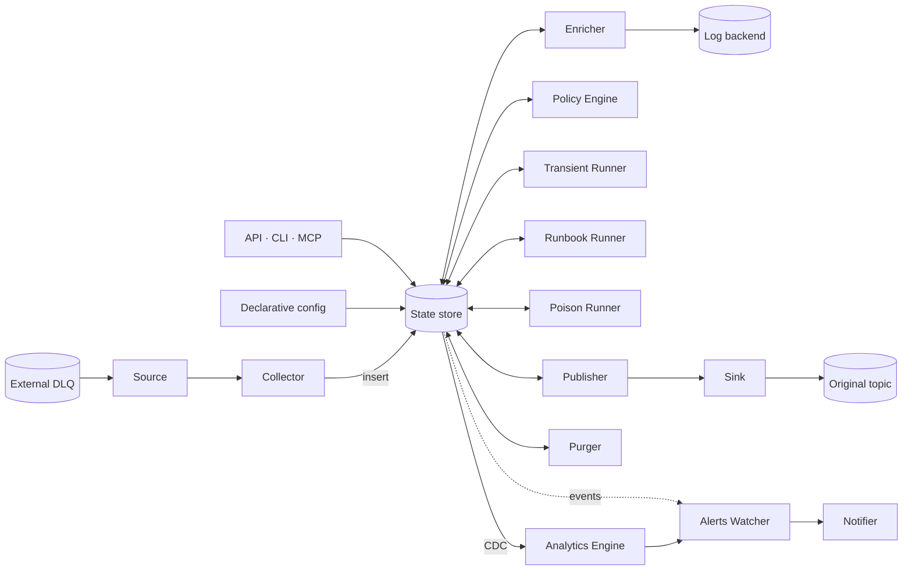
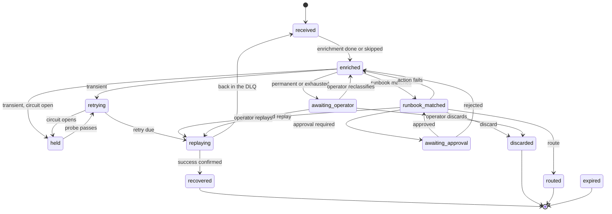

# Architecture

OpenDLQ follows the controller pattern used by Kubernetes. A single state store holds the state of every message and is the source of truth. Each component is a controller: it watches the messages in the state it owns, acts, and writes the new state. Components never call each other. The step-by-step sequence for each situation is in [flows](flows.md).

## Who decides

The **Policy Engine** is the only component that decides which path a message takes. The three **runners** execute a path:

| Path | Runner | Executes |
| --- | --- | --- |
| Transient | **Transient Runner** | Retry with backoff, circuit breaker, probe, drain |
| Known permanent | **Runbook Runner** | The declared runbook action, within its guardrails |
| Unknown permanent | **Poison Runner** | Grouping and announcement, so a person can decide |

A runner decides *how and when* within its path, following the declared `Policy`. It never picks another path. When a runner reaches the end of its path without success (a runbook action fails, an approval is rejected), it returns the message to `enriched` with the outcome recorded, and the Policy Engine decides again. Operators are the other decision point: their actions are explicit and audited.

In Kubernetes terms, the Policy Engine plays the scheduler and the runners play the kubelet.

## Rules of the model

- A controller takes work with `SELECT ... FOR UPDATE SKIP LOCKED`. Two instances never take the same message.
- Every state change uses compare-and-set on `version`. A concurrent change fails and is discarded.
- Every state change writes a row to `transitions` in the same transaction. That table is both the audit log and the fact table for analytics.
- `LISTEN/NOTIFY` only wakes controllers up. It is not a source of truth. Without it, the controller finds the work on its next poll.
- No controller publishes to the broker. A controller that needs to replay writes a row to the `outbox` in the same transaction as the state change. Only the Publisher reads the outbox and publishes.
- An operator action is a write of desired state. The responsible controller carries it out.
- Any component can crash and restart without losing anything. The state is in the store.

## Components

| Component | Watches | Does | Writes | Plugins |
| --- | --- | --- | --- | --- |
| **Collector** | Source | Consumes the DLQ. Extracts headers and correlation IDs. Computes `group_key`. Recognizes re-entries by `x-dlq-id`. Calls no external service. Commits the offset after the insert. | New message or re-entry in `received` | Source, Serde |
| **Enricher** | `received` | Queries the configured sources by correlation IDs, or reuses a recent result for the same group. Never blocks: on failure or timeout it moves on with `unavailable`. | `enrichments` row; `enriched` | Log Provider |
| **Policy Engine** | `enriched` | Classifies. Checks exhaustion. Routes by precedence: exhausted, matching runbook, transient, permanent. Skips paths that already failed for this message. | `runbook_matched`, `retrying`, `held` or `awaiting_operator` | Classifier |
| **Transient Runner** | `retrying` due; `held`; `replaying` | Schedules retries with backoff. Opens and closes circuit breakers. Runs probes. Confirms recovery. | `outbox`; `replaying`, `held`, `retrying`, `recovered` or `received` | Probe, Recovery Detector |
| **Runbook Runner** | `runbook_matched` | Executes the runbook action within its guardrails. Records each step. Returns failures to the Policy Engine. | `outbox`; `replaying`, `routed`, `discarded`, `awaiting_approval` or `enriched` | Transformer, Runbook Action |
| **Poison Runner** | `awaiting_operator` not yet announced | Updates the cause group. Emits an event. | `notified_at`; `poisoned` event | — |
| **Publisher** | Pending `outbox` rows | Serializes and publishes to the target. Marks the row as sent. | `outbox.sent_at` | Sink, Serde |
| **Purger** | Expired messages; payloads past retention | Moves messages to `expired`. Archives and deletes payloads. Never deletes `transitions`. | `expired`; archived payload | Store |
| **Analytics Engine** | `transitions` (CDC or rollup) | Computes funnel, cost, trends, recurrence. Exports OpenTelemetry and `/metrics`. Serves `/analytics`. | Rollups; analytic condition events | — |
| **Alerts Watcher** | Events from `transitions` and Analytics; alert instances | Evaluates declared `Alert` resources. The only component that notifies. | Alert instances: `pending`, `sent` | Notifier |

The Collector never queries logs. If the logging backend is down, ingestion continues, and the Enricher moves messages on with `unavailable` after its timeout.

Runners never notify. They emit events (`exhausted`, `poisoned`, `runbook_step`). The Alerts Watcher decides whether and whom to notify.

## Message state machine

| State | Meaning | Left by |
| --- | --- | --- |
| `received` | Stored by the Collector, not yet enriched | Enricher |
| `enriched` | Enrichment finished (or skipped, or unavailable). Ready to classify | Policy Engine |
| `retrying` | Transient, retry scheduled at `next_retry_at` | Transient Runner |
| `held` | Transient, dependency circuit open. Nothing is scheduled | Transient Runner |
| `replaying` | In the outbox or published, waiting for confirmation | Transient Runner or Collector |
| `runbook_matched` | A runbook matched and will act | Runbook Runner |
| `awaiting_approval` | The runbook's guardrail requires approval | Operator |
| `awaiting_operator` | Permanent or exhausted. Grouped by cause, waiting for a decision | Operator |
| `recovered` | Terminal. The consumer processed it successfully | — |
| `discarded` | Terminal. Dropped with a reason | — |
| `routed` | Terminal. Sent to another destination by a runbook | — |
| `expired` | Terminal. TTL reached from any open state | — |

- Exhausted is not a state. When attempts reach the policy maximum, the Policy Engine sends the message to `awaiting_operator`.
- There is no automatic transition out of `awaiting_operator`. An operator replays, discards, or reclassifies; a reclassification sends the message back to `enriched` and the Policy Engine routes it with the operator's classification.
- A message returned to `enriched` keeps its history. The Policy Engine does not route it again to a path that already failed for it.
- A replayed message that fails again returns to the DLQ with the same `x-dlq-id`. The Collector attaches the new attempt to the existing record and moves it back to `received`. The message keeps its identity.
- Time in `held` does not count as an attempt.

## Message record

| Field | Type | Holds |
| --- | --- | --- |
| `id` | UUID | Identity in OpenDLQ. Sent as `x-dlq-id` on every replay |
| `source_topic`, `partition`, `offset` | string, int, int | Where it came from in the DLQ |
| `original_topic`, `partition_key` | string, bytes | Where it goes back, and with which key |
| `payload`, `headers` | bytes, map | The message as it arrived |
| `consumer` | string | Who failed |
| `failure_kind` | enum | `transient`, `permanent`, `unknown` |
| `failure_reason`, `failure_dependency` | string | Short error and dependency involved |
| `group_key` | string | Grouping key by root cause |
| `classified_by` | enum | `header`, `rule`, `group`, `logs`, `inference`, `operator` |
| `state`, `version` | enum, int | Current state and version for compare-and-set |
| `attempts` | list | Each attempt: when, result, error |
| `next_retry_at` | timestamp | Next scheduled retry |
| `runbook` | string | Name and version of the matching runbook |
| `expires_at` | timestamp | TTL deadline |
| `notified_at` | timestamp | When the Poison Runner announced it |
| `enrichment_id` | UUID | Reference to the result in `enrichments`. See [enrichment](enrichment.md) |
| `correlation` | map | Correlation IDs extracted from headers |

The history of state changes and the audit trail live in `transitions`, not on the message.

## Plugins

| Plugin | Contract | Examples |
| --- | --- | --- |
| Source | Read messages from a DLQ and confirm the read | Kafka, SQS, RabbitMQ, Pub/Sub |
| Sink | Publish a replayed message | Original topic, another topic, HTTP |
| Serde | `Deserialize(bytes, schema)` and `Serialize(value, schema)` | JSON, Avro, Protobuf |
| Classifier | Message + error → kind, dependency, grouping key | Default by header and rule; team plugin |
| Transformer | Payload → corrected payload | JSONata, CEL, code |
| Probe | Check whether a dependency is back | Canary with a real message, HTTP health check |
| Recovery Detector | Confirm that a replay succeeded | Ack topic, no return within N s |
| Log Provider | Correlation IDs + time window → logs | Elasticsearch, Loki, CloudWatch, Datadog Logs |
| Notifier | Deliver an alert | Slack, PagerDuty, Opsgenie, webhook |
| Runbook Action | Execute a declared step | Transform and replay, route, discard, call an API |
| Store | Persist state, outbox and audit log | Postgres in V0 |

Three levels of extension:

1. **Expressions in configuration** (CEL, JSONata). Cover most classifiers, transformers and matches. No build step.
2. **Out-of-process plugins** (gRPC in the `hashicorp/go-plugin` model, or WASM). For domain logic. Isolate failures. Any language.
3. **Compiled adapters** (Go interfaces). For Source, Sink, Serde, Store and Log Provider. Maintained by the project.

Not pluggable: the state machine, the resource model, the audit log, the header contract, the analytics calculations and the runbook guardrails. That is what keeps every installation compatible. Changing the core is a fork.

## Store requirements

A pluggable store must provide ACID transactions across `messages`, `transitions`, `outbox` and `enrichments`; compare-and-set per row; and row locks with skip. A database without all three cannot be a store. The analytics database is separate and has no such requirements.

## Consistency guarantees

| Where | Guarantee | Mechanism |
| --- | --- | --- |
| Ingestion | No message lost; none duplicated in the store | Insert before offset commit; unique constraint on `(topic, partition, offset)` |
| State changes | One decision per message at a time | `SKIP LOCKED` + compare-and-set on `version` |
| Replay | One decision produces one send from OpenDLQ | Transactional outbox |
| Audit | Every state change recorded | `transitions` in the same transaction |
| Analytics | Eventual, with a declared maximum lag | CDC or periodic rollup |
| Consumer | Not guaranteed by OpenDLQ | Idempotency key in the header; the consumer deduplicates |
