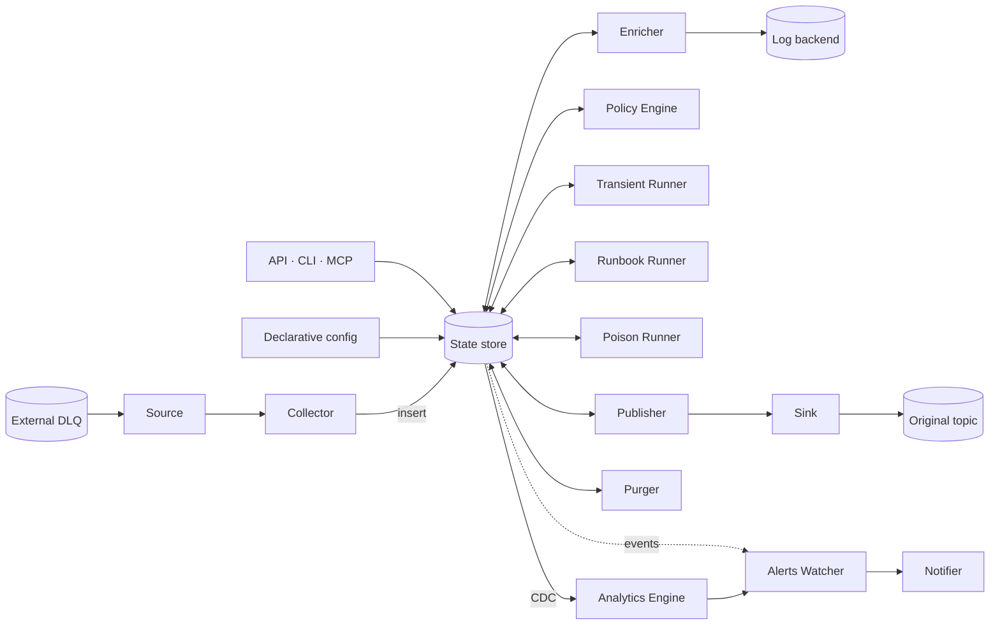

# Architecture

OpenDLQ follows the controller pattern used by Kubernetes. A single state store holds the state of every message and is the source of truth. Each component is a controller: it watches the messages in the state it owns, acts, and writes the new state. Components never call each other. The step-by-step sequence for each situation is in [flows](flows.md).

## Who decides

The **Policy Engine** is the only component that decides which path a message takes. The three **runners** execute a path:

| Path | Runner | Executes |
| --- | --- | --- |
| Transient | **Transient Runner** | Retry with backoff, circuit breaker, probe, drain |
| Known permanent | **Runbook Runner** | The declared runbook action, within its guardrails |
| Unknown permanent | **Poison Runner** | Grouping and announcement, so a person can decide |

A runner decides *how and when* within its path, following the declared `Policy`. It never picks another path. When a runner reaches the end of its path without success (a runbook action fails, an approval is rejected), it returns the message to `enriched` with the outcome recorded, and the Policy Engine decides again. Operators are the other decision point: their actions are explicit and audited.

In Kubernetes terms, the Policy Engine plays the scheduler and the runners play the kubelet.

## Rules of the model

- A controller takes work with `SELECT ... FOR UPDATE SKIP LOCKED`. Two instances never take the same message.
- Every state change uses compare-and-set on `version`. A concurrent change fails and is discarded.
- Every state change writes a row to `transitions` in the same transaction. That table is both the audit log and the fact table for analytics.
- `LISTEN/NOTIFY` only wakes controllers up. It is not a source of truth. Without it, the controller finds the work on its next poll.
- No controller publishes to the broker. A controller that needs to replay writes a row to the `outbox` in the same transaction as the state change. Only the Publisher reads the outbox and publishes.
- An operator action is a write of desired state. The responsible controller carries it out.
- Any component can crash and restart without losing anything. The state is in the store.

## Components

| Component | Watches | Does | Writes | Plugins |
| --- | --- | --- | --- | --- |
| **Collector** | Source | Consumes the DLQ. Extracts headers and correlation IDs. Computes `group_key`. Recognizes re-entries by `x-dlq-id`. Calls no external service. Commits the offset after the insert. | New message or re-entry in `received` | Source, Serde |
| **Enricher** | `received` | Queries the configured sources by correlation IDs, or reuses a recent result for the same group. Never blocks: on failure or timeout it moves on with `unavailable`. | `enrichments` row; `enriched` | Log Provider |
| **Policy Engine** | `enriched` | Classifies. Checks exhaustion. Routes by precedence: exhausted, matching runbook, transient, permanent. Skips paths that already failed for this message. | `runbook_matched`, `retrying`, `held` or `awaiting_operator` | Classifier |
| **Transient Runner** | `retrying` due; `held`; `replaying` | Schedules retries with backoff. Opens and closes circuit breakers. Runs probes. Confirms recovery. | `outbox`; `replaying`, `held`, `retrying`, `recovered` or `received` | Probe, Recovery Detector |
| **Runbook Runner** | `runbook_matched` | Executes the runbook action within its guardrails. Records each step. Returns failures to the Policy Engine. | `outbox`; `replaying`, `routed`, `discarded`, `awaiting_approval` or `enriched` | Transformer, Runbook Action |
| **Poison Runner** | `awaiting_operator` not yet announced | Updates the cause group. Emits an event. | `notified_at`; `poisoned` event | — |
| **Publisher** | Pending `outbox` rows | Serializes and publishes to the target. Marks the row as sent. | `outbox.sent_at` | Sink, Serde |
| **Purger** | Expired messages; payloads past retention | Moves messages to `expired`. Archives and deletes payloads. Never deletes `transitions`. | `expired`; archived payload | Store |
| **Analytics Engine** | `transitions` (CDC or rollup) | Computes funnel, cost, trends, recurrence. Exports OpenTelemetry and `/metrics`. Serves `/analytics`. | Rollups; analytic condition events | — |
| **Alerts Watcher** | Events from `transitions` and Analytics; alert instances | Evaluates declared `Alert` resources. The only component that notifies. | Alert instances: `pending`, `sent` | Notifier |

The Collector never queries logs. If the logging backend is down, ingestion continues, and the Enricher moves messages on with `unavailable` after its timeout.

Runners never notify. They emit events (`exhausted`, `poisoned`, `runbook_step`). The Alerts Watcher decides whether and whom to notify.

## State machine and plugins

- The states, their owners and the message record are in [state machine](state-machine.md).
- Plugin contracts and extension levels are in [plugins](plugins.md).

## Store requirements

See [State Store](components/state-store.md#store-requirements).

## Consistency guarantees

| Where | Guarantee | Mechanism |
| --- | --- | --- |
| Ingestion | No message lost; none duplicated in the store | Insert before offset commit; unique constraint on `(topic, partition, offset)` |
| State changes | One decision per message at a time | `SKIP LOCKED` + compare-and-set on `version` |
| Replay | A replay exists only if its decision was committed. Published at least once, with the same `x-dlq-attempt` on every copy | Transactional outbox |
| Audit | Every state change recorded | `transitions` in the same transaction |
| Analytics | Eventual, with a declared maximum lag | CDC or periodic rollup |
| Consumer | Not guaranteed by OpenDLQ | Idempotency key in the header; the consumer deduplicates |
