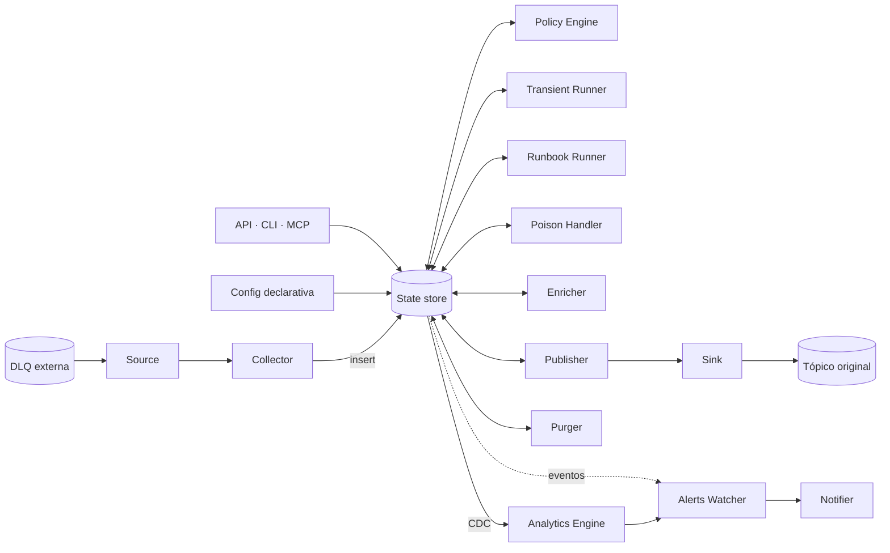
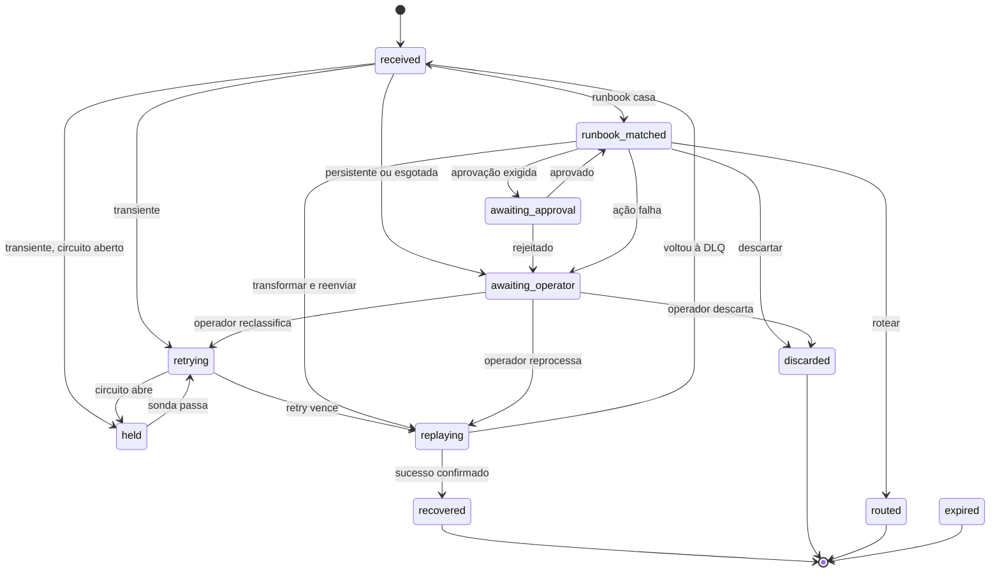

# Arquitetura

[English](architecture.md)

O OpenDLQ segue o padrão de controllers do Kubernetes. Um único state store guarda o estado de cada mensagem e é a fonte de verdade. Cada componente é um controller: observa as mensagens no estado que lhe cabe, age e grava o novo estado. Os componentes nunca chamam uns aos outros.

## Regras do modelo

- Um controller pega trabalho com `SELECT ... FOR UPDATE SKIP LOCKED`. Duas instâncias nunca pegam a mesma mensagem.
- Toda mudança de estado usa compare-and-set em `version`. Uma mudança concorrente falha e é descartada.
- Toda mudança de estado grava uma linha em `transitions` na mesma transação. Essa tabela é o log de auditoria e a tabela fato do analytics.
- `LISTEN/NOTIFY` só acorda os controllers. Não é fonte de verdade. Sem ele, o controller acha o trabalho no próximo poll.
- Nenhum controller publica no broker. Um controller que precisa reenviar grava uma linha no `outbox` na mesma transação da mudança de estado. Só o Publisher lê o outbox e publica.
- Uma ação de operador é uma escrita de estado desejado. O controller responsável executa.
- Qualquer componente pode cair e reiniciar sem perder nada. O estado está no store.

## Componentes

| Componente | Observa | Faz | Grava | Plugins |
| --- | --- | --- | --- | --- |
| **Collector** | Source | Consome a DLQ. Extrai headers e ids de correlação. Reconhece reentradas pelo `x-dlq-id`. Não chama serviço externo. Commita o offset depois do insert. | Nova mensagem ou reentrada em `received` | Source, Serde |
| **Policy Engine** | `received` | Classifica. Verifica esgotamento. Despacha por precedência: runbook que casa, depois transiente, depois persistente. | `runbook_matched`, `retrying`, `held` ou `awaiting_operator` | Classifier |
| **Transient Runner** | `retrying` vencido; `held`; `replaying` | Agenda retries com backoff. Abre e fecha circuit breakers. Roda sondas. Confirma recuperação. | `outbox`; `replaying`, `held`, `retrying`, `recovered` ou `received` | Probe, Recovery Detector |
| **Runbook Runner** | `runbook_matched` | Executa a ação do runbook dentro dos guardrails. Registra cada passo. | `outbox`; `replaying`, `routed`, `discarded`, `awaiting_approval` ou `awaiting_operator` | Transformer, Runbook Action |
| **Poison Handler** | `awaiting_operator` ainda não anunciada | Atualiza o grupo da causa. Emite evento. | `notified_at`; evento `poisoned` | — |
| **Enricher** | Mensagens com ids de correlação sem enriquecimento | Busca logs pelo trace id, com retry. Assíncrono: nunca bloqueia outro controller. | Link e trecho do log | Log Provider |
| **Publisher** | Linhas pendentes no `outbox` | Serializa e publica no destino. Marca a linha como enviada. | `outbox.sent_at` | Sink, Serde |
| **Purger** | Mensagens expiradas; payloads além da retenção | Move mensagens para `expired`. Arquiva e apaga payloads. Nunca apaga `transitions`. | `expired`; payload arquivado | Store |
| **Analytics Engine** | `transitions` (CDC ou rollup) | Calcula funil, custo, tendência, reincidência. Exporta OpenTelemetry e `/metrics`. Serve `/analytics`. | Rollups; eventos de condição analítica | — |
| **Alerts Watcher** | Eventos de `transitions` e do Analytics | Avalia os recursos `Alert` declarados. Único componente que notifica. | Registro de alerta | Notifier |

O Collector nunca consulta logs. Se o backend de logs cair, a ingestão continua.

Runners nunca notificam. Eles emitem eventos (`exhausted`, `poisoned`, `runbook_step`). O Alerts Watcher decide se e para quem notificar.

## Máquina de estados da mensagem

| Estado | Significado | Quem tira dele |
| --- | --- | --- |
| `received` | Gravada pelo Collector, ainda não classificada | Policy Engine |
| `retrying` | Transiente, retry agendado em `next_retry_at` | Transient Runner |
| `held` | Transiente, circuito da dependência aberto. Nada é agendado | Transient Runner |
| `replaying` | No outbox ou já publicada, esperando confirmação | Transient Runner ou Collector |
| `runbook_matched` | Um runbook casou e vai agir | Runbook Runner |
| `awaiting_approval` | O guardrail do runbook exige aprovação | Operador |
| `awaiting_operator` | Persistente ou esgotada. Agrupada por causa, esperando decisão | Operador |
| `recovered` | Terminal. O consumer processou com sucesso | — |
| `discarded` | Terminal. Descartada com motivo | — |
| `routed` | Terminal. Enviada a outro destino por runbook | — |
| `expired` | Terminal. TTL atingido em qualquer estado aberto | — |

- Esgotada não é um estado. Quando as tentativas atingem o máximo da política, o Policy Engine manda a mensagem para `awaiting_operator`.
- Não há transição automática de `awaiting_operator` para `retrying`. Só um operador reclassifica.
- Uma mensagem reprocessada que falha de novo volta à DLQ com o mesmo `x-dlq-id`. O Collector anexa a nova tentativa ao registro existente e o devolve a `received`. A mensagem mantém a identidade.
- Tempo em `held` não conta como tentativa.

## Registro da mensagem

| Campo | Tipo | Guarda |
| --- | --- | --- |
| `id` | UUID | Identidade no OpenDLQ. Vai como `x-dlq-id` em todo replay |
| `source_topic`, `partition`, `offset` | string, int, int | De onde veio na DLQ |
| `original_topic`, `partition_key` | string, bytes | Para onde volta e com qual chave |
| `payload`, `headers` | bytes, map | A mensagem como chegou |
| `consumer` | string | Quem falhou |
| `failure_kind` | enum | `transient`, `permanent`, `unknown` |
| `failure_reason`, `failure_dependency` | string | Erro resumido e dependência envolvida |
| `group_key` | string | Chave de agrupamento por causa raiz |
| `classified_by` | enum | `header`, `rule`, `inference`, `operator` |
| `state`, `version` | enum, int | Estado atual e versão para compare-and-set |
| `attempts` | lista | Cada tentativa: quando, resultado, erro |
| `next_retry_at` | timestamp | Próximo retry agendado |
| `runbook` | string | Nome e versão do runbook que casou |
| `expires_at` | timestamp | Prazo do TTL |
| `notified_at` | timestamp | Quando o Poison Handler anunciou a mensagem |

O histórico de mudanças de estado e a trilha de auditoria ficam em `transitions`, não na mensagem.

## Plugins

| Plugin | Contrato | Exemplos |
| --- | --- | --- |
| Source | Ler mensagens de uma DLQ e confirmar a leitura | Kafka, SQS, RabbitMQ, Pub/Sub |
| Sink | Publicar uma mensagem reprocessada | Tópico original, outro tópico, HTTP |
| Serde | `Deserialize(bytes, schema)` e `Serialize(valor, schema)` | JSON, Avro, Protobuf |
| Classifier | Mensagem + erro → tipo, dependência, chave de agrupamento | Padrão por header e regra; plugin do time |
| Transformer | Payload → payload corrigido | JSONata, CEL, código |
| Probe | Verificar se a dependência voltou | Canário com mensagem real, health check HTTP |
| Recovery Detector | Confirmar que o replay teve sucesso | Tópico de ack, ausência de retorno em N s |
| Log Provider | Ids de correlação + janela de tempo → logs | Elasticsearch, Loki, CloudWatch, Datadog Logs |
| Notifier | Entregar um alerta | Slack, PagerDuty, Opsgenie, webhook |
| Runbook Action | Executar um passo declarado | Transformar e reenviar, rotear, descartar, chamar uma API |
| Store | Persistir estado, outbox e log de auditoria | Postgres na V0 |

Três níveis de extensão:

1. **Expressões na configuração** (CEL, JSONata). Cobrem a maioria dos classifiers, transformers e matches. Sem build.
2. **Plugins fora do processo** (gRPC no modelo `hashicorp/go-plugin`, ou WASM). Para lógica de domínio. Isolam falhas. Qualquer linguagem.
3. **Adapters compilados** (interfaces Go). Para Source, Sink, Serde, Store e Log Provider. Mantidos pelo projeto.

Não é plugável: a máquina de estados, o modelo de recursos, o log de auditoria, o contrato de headers, os cálculos de analytics e os guardrails de runbook. É isso que mantém toda instalação compatível. Mudar o núcleo é fork.

## Requisitos do store

Um store plugável precisa oferecer transações ACID entre `messages`, `transitions` e `outbox`; compare-and-set por linha; e lock de linha com skip. Um banco sem as três garantias não serve como store. O banco de analytics é separado e não tem esses requisitos.

## Garantias de consistência

| Onde | Garantia | Mecanismo |
| --- | --- | --- |
| Ingestão | Nenhuma mensagem perdida; nenhuma duplicada no store | Insert antes do commit de offset; constraint única em `(topic, partition, offset)` |
| Mudanças de estado | Uma decisão por mensagem por vez | `SKIP LOCKED` + compare-and-set em `version` |
| Replay | Uma decisão gera um envio pelo OpenDLQ | Transactional outbox |
| Auditoria | Toda mudança de estado registrada | `transitions` na mesma transação |
| Analytics | Eventual, com atraso máximo declarado | CDC ou rollup periódico |
| Consumer | Não garantido pelo OpenDLQ | Chave de idempotência no header; o consumer deduplica |
