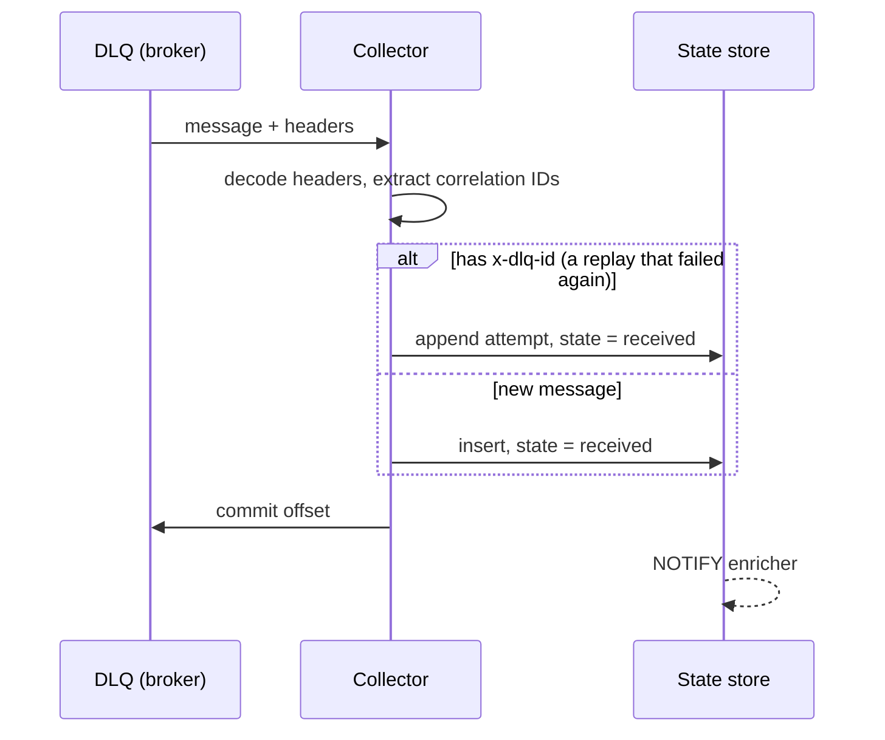
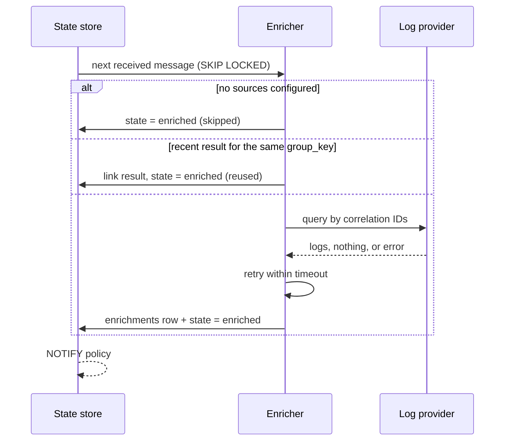
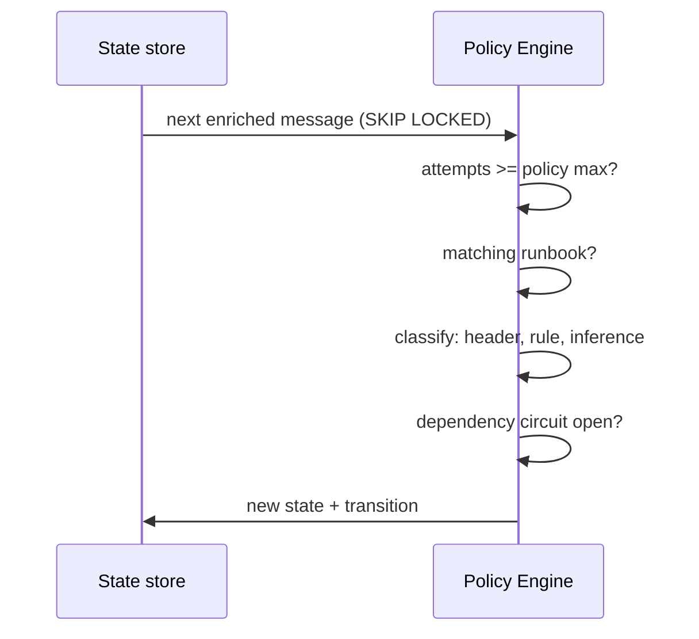
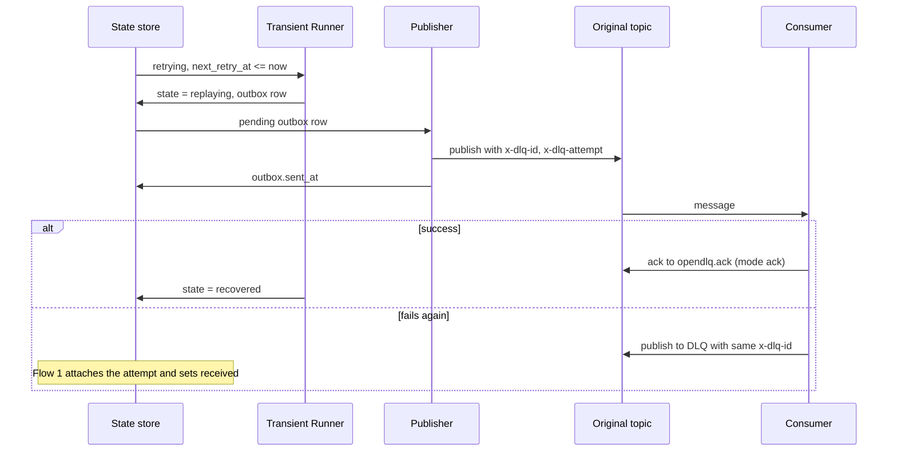
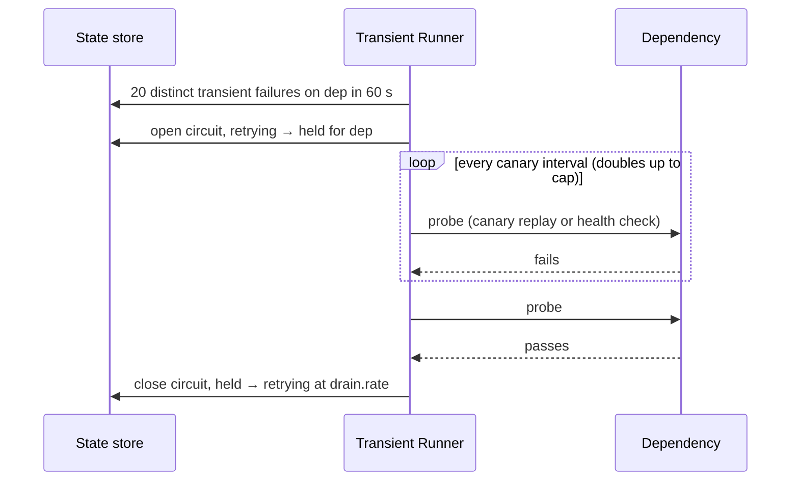
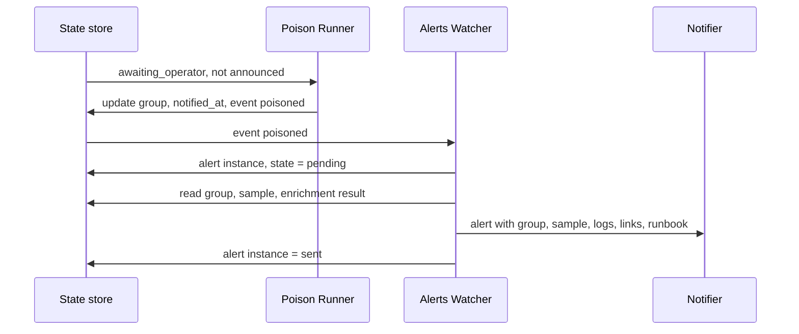
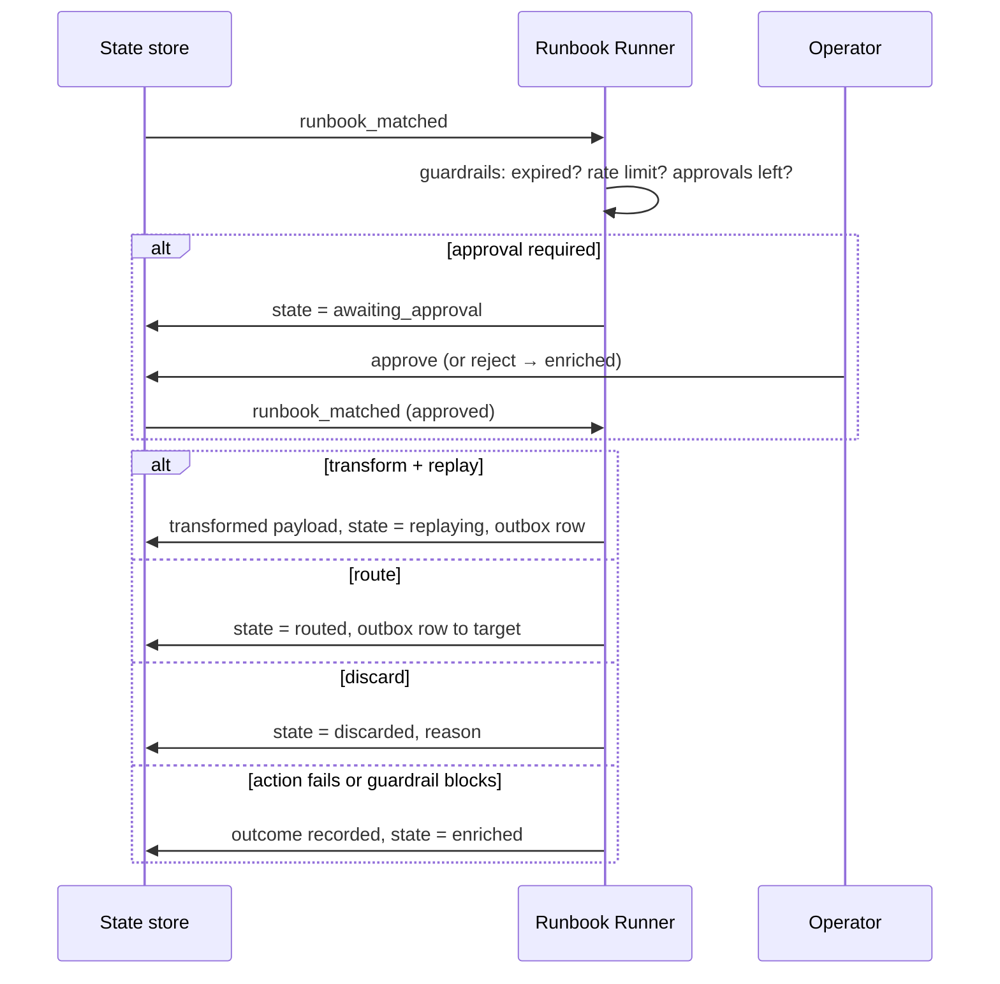
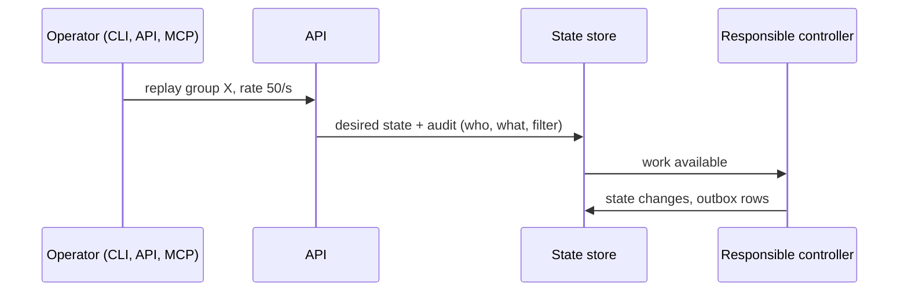
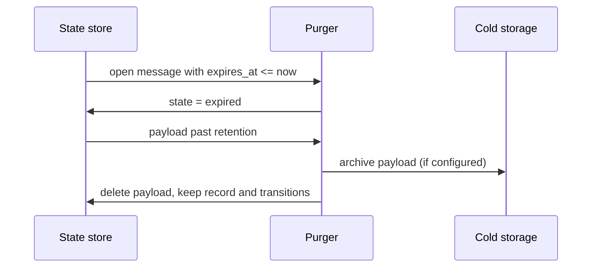
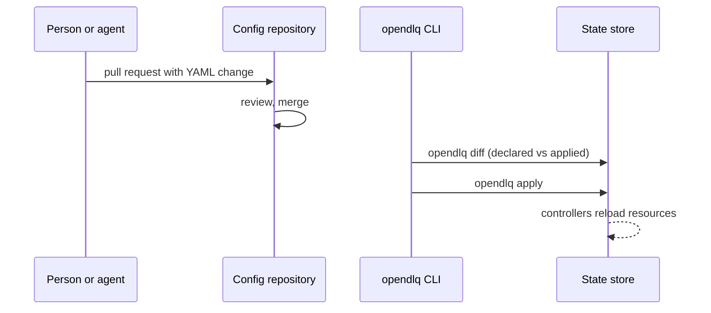

# Flows

How a message moves through OpenDLQ in each situation. Every arrow into the state store is a single transaction that changes the message state, writes a row to `transitions`, and, when something must be published, writes a row to the `outbox`. Components never call each other; they read and write state. See [architecture](architecture.md) for the rules and the full state machine.

| Flow | Starts with | Ends with |
| --- | --- | --- |
| [1. Ingestion](#1-ingestion) | A message lands in the DLQ | `received` |
| [2. Enrichment](#2-enrichment) | `received` | `enriched` |
| [3. Classification](#3-classification) | `enriched` | `retrying`, `held`, `runbook_matched` or `awaiting_operator` |
| [4. Transient recovery](#4-transient-recovery) | `retrying` | `recovered`, or back to `received` |
| [5. Dependency outage](#5-dependency-outage) | Many failures on one dependency | Backlog drained |
| [6. Permanent failure and alert](#6-permanent-failure-and-alert) | `awaiting_operator` | Alert sent, with logs |
| [7. Runbook](#7-runbook) | `runbook_matched` | `replaying`, `routed`, `discarded`, or back to `enriched` |
| [8. Operator action](#8-operator-action) | An operator command | `replaying`, `discarded`, or back to `enriched` |
| [9. Expiry and purge](#9-expiry-and-purge) | TTL or retention reached | `expired`, payload archived |
| [10. Configuration change](#10-configuration-change) | A YAML change | Resources applied |

## 1. Ingestion

- The offset is committed only after the transaction commits. A crash in between re-delivers the message; the unique constraint on `(topic, partition, offset)` makes the second insert a no-op.
- The Collector computes `group_key` from headers. It calls no external service, so nothing outside the broker and the store can stop ingestion.

## 2. Enrichment

- The `enrichments` row and the state change are one transaction. The Policy Engine never sees `enriched` without the data.
- A source that fails or times out produces `unavailable`, not a stuck message.
- See [enrichment](components/enricher.md).

## 3. Classification

Precedence:

1. Attempts exhausted → `awaiting_operator`.
2. A runbook matches → `runbook_matched`.
3. Transient and the dependency circuit is open → `held`.
4. Transient → `retrying`, with `next_retry_at` from the backoff.
5. Permanent → `awaiting_operator`.

An operator's classification, when present, replaces the classifier's answer.

A path that already failed for this message (a runbook that failed or was rejected) is skipped. See [classification](components/policy-engine.md) for how the kind is decided.

## 4. Transient recovery

- In `silence` mode, the Transient Runner marks the message `recovered` when it does not come back within the configured window.
- A message that comes back goes through enrichment and classification again. Enrichment usually reuses the group's result. Exhaustion is checked in classification.

## 5. Dependency outage

- Held messages keep their attempt count. Time held is not an attempt.
- The drain releases messages in arrival order, at `drain.rate`, and keeps partition-key order.
- Opening and closing the circuit are events. The Alerts Watcher can alert on them.

## 6. Permanent failure and alert

- The message was enriched before it was classified, so the alert has logs, or the reason they are missing, with no extra wait.
- `dedupe` keeps the same alert for the same group from repeating.

## 7. Runbook

- The Runbook Runner never picks another path. A failure goes back to `enriched`, and the Policy Engine routes the message again without that runbook.
- An expired runbook never matches. The messages it covered go to whichever path the Policy Engine picks next, usually `awaiting_operator`.
- Every step writes the runbook name and version to `transitions`.

## 8. Operator action

- The API never publishes. It writes the decision; the controllers execute it.
- Edit-and-replay stores the new payload with the decision. The original payload stays in history.
- Reclassifying sends the messages back to `enriched` with the operator's classification, and the Policy Engine routes them. Reclassifying permanent as transient is the only path back to automatic retries.

## 9. Expiry and purge

## 10. Configuration change

- A change made through the API or UI to a declared resource is drift. `opendlq diff` shows it; `export` keeps it, `apply` discards it.
- Resources are versioned. Every transition records the version of the policy, classifier or runbook that decided it.
