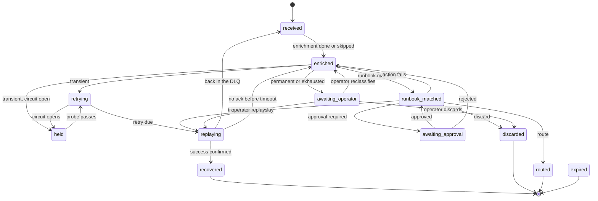

# State machine

Every message in OpenDLQ is in exactly one state. Each open state has one owner: the only component that moves a message out of it. Components are described in [architecture](architecture.md#components).

## States

| State | Meaning | Left by |
| --- | --- | --- |
| `received` | Stored by the Collector, not yet enriched | Enricher |
| `enriched` | Enrichment finished (or skipped, or unavailable). Ready to classify | Policy Engine |
| `retrying` | Transient, retry scheduled at `next_retry_at` | Transient Runner |
| `held` | Transient, dependency circuit open. Nothing is scheduled | Transient Runner |
| `replaying` | In the outbox or published, waiting for confirmation | Transient Runner (success or timeout) or Collector (back in the DLQ) |
| `runbook_matched` | A runbook matched and will act | Runbook Runner |
| `awaiting_approval` | The runbook's guardrail requires approval | Operator |
| `awaiting_operator` | Permanent or exhausted. Grouped by cause, waiting for a decision | Operator |
| `recovered` | Terminal. The consumer processed it successfully | — |
| `discarded` | Terminal. Dropped with a reason | — |
| `routed` | Terminal. Sent to another destination by a runbook | — |
| `expired` | Terminal. TTL reached from any open state | — |

- Exhausted is not a state. When attempts reach the policy maximum, the Policy Engine sends the message to `awaiting_operator`.
- There is no automatic transition out of `awaiting_operator`. An operator replays, discards, or reclassifies; a reclassification sends the message back to `enriched` and the Policy Engine routes it with the operator's classification.
- A message returned to `enriched` keeps its history. The Policy Engine does not route it again to a path that already failed for it.
- A replayed message that fails again returns to the DLQ with the same `x-dlq-id`. The Collector attaches the new attempt to the existing record and moves it back to `received`. The message keeps its identity.
- Time in `held` does not count as an attempt.

## Message record

| Field | Type | Holds |
| --- | --- | --- |
| `id` | UUID | Identity in OpenDLQ. Sent as `x-dlq-id` on every replay |
| `source_topic`, `partition`, `offset` | string, int, int | Where it came from in the DLQ |
| `original_topic`, `partition_key` | string, bytes | Where it goes back, and with which key |
| `payload`, `headers` | bytes, map | The message as it arrived |
| `consumer` | string | Who failed |
| `failure_kind` | enum | `transient`, `permanent`, `unknown` |
| `failure_reason`, `failure_dependency` | string | Short error and dependency involved |
| `group_key` | string | Grouping key by root cause |
| `classified_by` | enum | `header`, `rule`, `group`, `logs`, `inference`, `operator` |
| `state`, `version` | enum, int | Current state and version for compare-and-set |
| `attempts` | list | Each attempt: when, result, error |
| `next_retry_at` | timestamp | Next scheduled retry |
| `runbook` | string | Name and version of the matching runbook |
| `expires_at` | timestamp | TTL deadline |
| `notified_at` | timestamp | When the Poison Runner announced it |
| `enrichment_id` | UUID | Reference to the result in `enrichments`. See [enrichment](components/enricher.md) |
| `correlation` | map | Correlation IDs extracted from headers |

The history of state changes and the audit trail live in `transitions`, not on the message.
