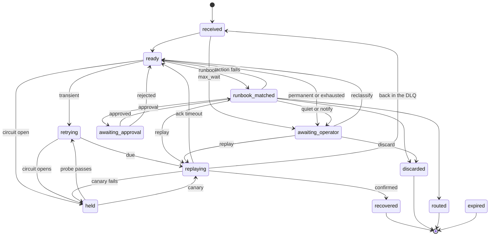

# State machine

Every message in OpenDLQ is in exactly one state. A state says what the message is waiting for, not what happened to it. What happened is stored in attributes, such as `enrichment_status` and `attempts`.

## Rules

- **One controller per state.** Each open state has exactly one controller that moves messages out of it automatically. That prevents duplicate work.
- **Events come from outside.** Four sources can also move a message: the Collector (re-entry), an operator, the Purger (TTL) and an ack. Events are listed apart from controller transitions.
- **Every write is optimistic locking.** A controller and an event can race on the same message. One wins. The other reads again.
- **Every failure returns to `ready`.** The Policy Engine is the only place where a message changes path.

## States

| State | Category | Waits for | Controller |
| --- | --- | --- | --- |
| `received` | Work | Enrichment | Enricher |
| `ready` | Work | A decision | Policy Engine |
| `retrying` | Timer | `next_retry_at` | Transient Runner |
| `held` | External wait | The dependency to recover | Transient Runner (probe) |
| `runbook_matched` | Work | The runbook to run | Runbook Runner |
| `awaiting_approval` | External wait | A person to approve | — (operator event) |
| `awaiting_operator` | External wait | A person to decide | — (operator event) |
| `replaying` | External wait | Confirmation from the consumer | Transient Runner |
| `recovered` | Terminal | — | — |
| `discarded` | Terminal | — | — |
| `routed` | Terminal | — | — |
| `expired` | Terminal | — | — |

`replaying` is shared by the three paths: transient retry, runbook and operator replay. Recovery detection is the same for all of them.

## Transitions

### Intake

```
—        → received            Collector stores the message. Offset committed after.
received → ready               Enricher sets enrichment_status.
received → awaiting_operator   Enricher. Only with on_unavailable: wait,
                               after max_wait, with after_max_wait: operator.
```

### Decision (Policy Engine)

```
ready → retrying            transient, circuit closed, attempts left
ready → held                transient, circuit open
ready → runbook_matched     a runbook matches, and that path has not failed before
ready → awaiting_operator   permanent with no runbook, or attempts exhausted
```

### Transient path (Transient Runner)

```
retrying → replaying   next_retry_at reached. Writes the outbox.
retrying → held        the circuit opened
held     → replaying   the oldest held message is sent as the canary. Writes the outbox.
held     → retrying    the probe passed. Drain at the declared rate.
```

### Runbook path (Runbook Runner)

```
runbook_matched → awaiting_approval   the guardrail requires approval
runbook_matched → replaying           replay, or transform and replay. Writes the outbox.
runbook_matched → routed              route
runbook_matched → discarded           discard
runbook_matched → awaiting_operator   quiet, or notify
runbook_matched → ready               the action failed. Path recorded as failed.
```

### Confirmation (Transient Runner)

```
replaying → recovered   ack for the current attempt, or the silence window passed
replaying → ready       no ack before the timeout. Attempt recorded as failed.
replaying → held        the canary was not acked. The circuit stays open. Not an attempt.
```

### Events

```
replaying         → received          Collector: re-entry with the same x-dlq-id
awaiting_approval → runbook_matched   operator approves
awaiting_approval → ready             operator rejects
awaiting_operator → replaying         operator replays. Writes the outbox.
awaiting_operator → ready             operator reclassifies
awaiting_operator → discarded         operator discards
any open state    → expired           Purger: expires_at reached
```

## Diagram



`expired` is reachable from every open state. It is not drawn, to keep the diagram readable.

## Edge cases

| Case | Behavior |
| --- | --- |
| Re-entry while not in `replaying` (a Publisher copy failed again) | One more attempt is recorded. The state does not change |
| Ack for an older attempt, or outside `replaying` | Ignored and recorded |
| An operator acts while a controller acts | Optimistic locking: one wins, the other reads again |
| TTL reached during `replaying` | `expired`. A later ack is ignored |
| Time in `held` | Does not count as an attempt |
| Attempts exhausted | Not a state. The Policy Engine sends the message to `awaiting_operator` |
| Re-entry | Goes to `received`, not `ready`. The new failure may have new logs |
| Re-entry of a closed message (silence mode counted a slow failure as recovered) | The closed message does not change. A new message is stored, linked to it. Counted as a false recovery |
| Runbook rate limit reached | The message stays in `runbook_matched` until the hourly budget frees up |
| Runbook expired while a message is in `runbook_matched` | The path is recorded as failed, reason `expired`. Back to `ready` |

## Message record

| Field | Type | Holds |
| --- | --- | --- |
| `id` | UUID | Identity in OpenDLQ. Sent as `x-dlq-id` on every replay |
| `source_topic`, `partition`, `offset` | string, int, int | Where it came from in the DLQ |
| `original_topic`, `partition_key` | string, bytes | Where it goes back, and with which key |
| `payload`, `headers` | bytes, map | The message as it arrived |
| `consumer` | string | Who failed |
| `failure_kind` | enum | `transient`, `permanent`, `unknown` |
| `failure_reason`, `failure_dependency` | string | Short error and dependency involved |
| `group_key` | string | Grouping key by root cause |
| `classified_by` | enum | `header`, `rule`, `group`, `logs`, `inference`, `operator`, `plugin` |
| `state`, `version` | enum, int | Current state, and the version for optimistic locking |
| `attempts` | list | Each attempt: when, result, error |
| `failed_paths` | list | Paths that already failed for this message. The Policy Engine skips them |
| `next_retry_at` | timestamp | Next scheduled retry |
| `runbook` | string | Name and version of the matching runbook |
| `expires_at` | timestamp | TTL deadline |
| `notified_at` | timestamp | When the Poison Runner announced it |
| `enrichment_status` | enum | `pending`, `enriched`, `reused`, `not_found`, `unavailable`, `skipped`. See [Enricher](components/enricher.md#when-a-source-is-unavailable) |
| `enrichment_id` | UUID | Reference to the result in `enrichments` |
| `next_enrich_at` | timestamp | Next enrichment attempt, with `on_unavailable: wait` |
| `correlation` | map | Correlation IDs extracted from headers |

The history of state changes and the audit trail live in `transitions`, not on the message.
